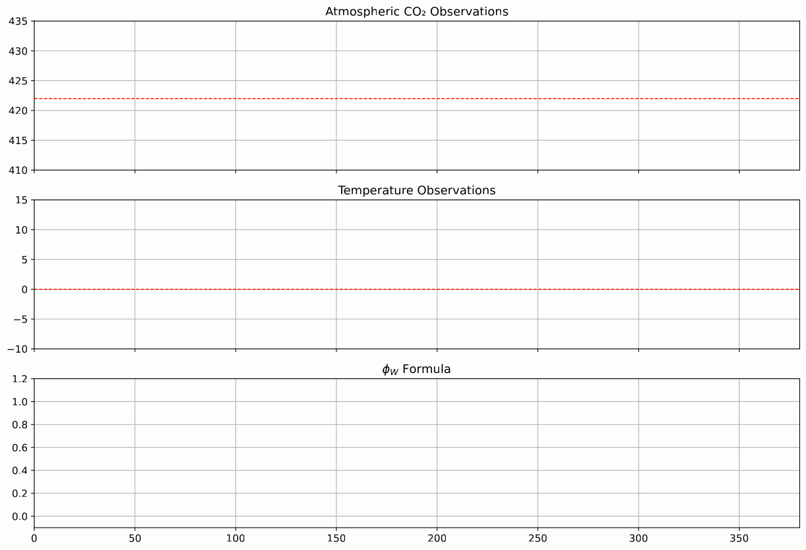
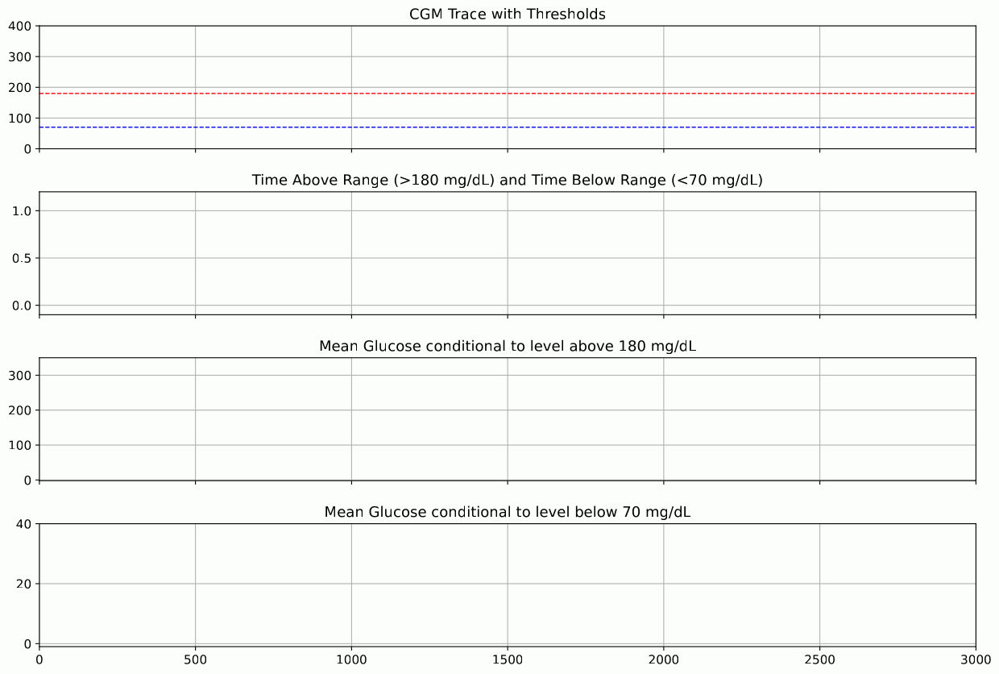

# Modular Specification and Online Evaluation of Temporal Logic Formulae

**Authors**: Simone Silvetti, Michele Loreti, Laura Nenzi

A Python framework for specifying temporal logic formulae in a modular way and evaluating them online (i.e., incrementally over incoming data streams). The library provides elementary building blocks (elements, nodes, functions) and notifiers for hooking into event conditions, along with example use cases.

---

## Table of Contents

- [Overview](#overview)
- [Features](#features)
- [What's new in 1.1.0](#whats-new-in-110)
- [Installation](#installation)
- [Specification language](#specification-language)
- [Repository Structure](#repository-structure)
- [Use Cases / Examples](#use-cases--examples)
- [Testing](#testing)
- [Contact](#contact)

---

## Overview

This project provides a purely Python-based framework for:
- **Modular specification** of temporal logic formulae in terms of atomic elements, operators, and composition.
- **Online (incremental) evaluation** of such formulae against input streams of symbolic states.
- **Notifiers** to trigger callbacks or actions when specified temporal conditions become true (or false).
- **Example use cases** (e.g., weather monitoring and continuous glucose monitoring) illustrating how to apply the framework to real-time data streams.

---

## Features

- **Elementary building blocks**: define predicates, signals, or atomic conditions as Python callables or expressions.
- **Temporal operators**: combine elements with temporal constructs.
- **Online evaluation engine**: processes incoming symbolic states one at a time, updating formula evaluation in constant or optimal time.
- **Notifiers / Callbacks**: register handlers that fire when a formula is satisfied and/or violated.
- **Modular design**: easy to extend with new predicate types, operators, or custom notifiers.
- **Test suite**: unit tests for core modules to ensure correctness.
- **Example use cases**: demonstrations (`usecase/weather` and `usecase/cgm`) showing how to integrate with data sources and drive the evaluation engine.

---

## What's new in 1.1.0

Bug fixes in the binary and n-ary nodes, in the input nodes and in the window minimum/maximum (now exact, with
Lemire's monotonic queue), faster arithmetic, removal of broken or unused operators, and end-to-end regression tests.
See [CHANGELOG.md](CHANGELOG.md).

---

## Installation

1. **Clone the repository**:
   ```bash
   git clone https://github.com/LogArtLab/gemon.git
   cd gemon
   ```
2. **Create a virtual environment** (recommended):
   ```bash
   python3 -m venv venv
   source venv/bin/activate   # on Windows: venv\Scripts\activate
   ```
3. **Install dependencies**:
   ```bash
   pip install -r requirements.txt
   ```
   Ensure you have at least the versions specified in `requirements.txt`.

---

## Specification language

A monitor can be written as text and compiled into a graph of gemon nodes
(`gemon.lang`, grammar in `gemon/lang/gemon.lark`, parsed with [Lark](https://github.com/lark-parser/lark)).
The CGM case study of `examples/RV2025/cgm/cgm.py` becomes:

```
input G : linear                      # piecewise-linear interpolation of the samples
param T = 180

TAR     := On[0, T] Int(G > 180) / T  # fraction of the next T seconds above 180 mg/dL
TBR     := On[0, T] Int(G < 70) / T
mean    := On[0, T] Int(G) / T
mean_AR := On[0, T] Int(G | G > 180) / T   # mean glucose where G > 180
mean_BR := On[0, T] Int(G | G < 70) / T
```

```python
from gemon.lang import compile_file

monitor = compile_file("cgm.gemon")
tar = monitor.observe("TAR")          # a Signal recording every interval of TAR
for t, g in samples:
    monitor.receive("G", t, g)
```

A program declares its inputs (`input x : const` or `linear`, the interpolation of the
samples), constant parameters (`param name = expression`) and named formulas
(`name := expression`); every formula can be observed. Equal sub-formulas, also across
formulas, are built once.

| Construct | Meaning | Nodes |
|---|---|---|
| `a + b`, `a - b` | sum, difference of signals | `SumNode`, `SubNode` |
| `a + c`, `a - c`, `c - a` | with a constant `c` | `AddConstNode` (and `MultiplyByConst(-1)`) |
| `a * c`, `a / c`, `-a` | scaling by a constant | `MultiplyByConst` |
| `\|a\|` or `abs(a)`, `min(a, b)`, `max(a, b)` | pointwise | `AbsNode`, `MinNode`, `MaxNode` |
| `a > c`, `a < c` | comparison with a constant (0/1 signal) | `HigherThanNode`, `LowerThanNode` |
| `a >= c`, `a <= c` | `not (a < c)`, `not (a > c)` | `NotNode` |
| `a > b` | `a - b > 0` | `SubNode`, `HigherThanNode(0)` |
| `and`, `or`, `not` | on 0/1 signals | `AndNode`, `OrNode`, `NotNode` |
| `On[0, b] Int(a)`, `Min`, `Max` | over the window `[t, t + b]` | `IntegralWindowNode`, `MinWindowNode`, `MaxWindowNode` |
| `On[a, b] Max(x)` | over `[t + a, t + b]` | window of length `b - a`, then `ShiftNode(-a)` |
| `On[0, b] Int(x \| c)` | filter: `x` where `c` holds, undefined elsewhere | `FilterNode`, then the window |

Precedence, lowest first: `or`, `and`, `not`, comparisons (not chained), `+ -`, `* /`,
unary minus. Numbers may carry a time unit written without a space (`300s`, `5min`,
`2h`, `1d`, `250ms`); they are converted to seconds, or to the unit set with
`timeunit ms` (any of the units), the unit of the timestamps. Comments start with `#`.

The compiler rejects, with line and column: undefined or duplicated names, products and
divisions between signals, windows with non-constant or invalid bounds, boolean
operators on numeric signals, and formulas of polynomial degree above 2 (e.g. `Int` of
`Int` of a linear signal), which gemon cannot represent exactly. The until operators of
the logic are not implemented in gemon and are not part of the language.

`gemon.lang.graph.describe` gives a canonical description of any graph of gemon nodes
(nodes, parameters, wiring, sharing): the tests use it to check that every compiled
program is the same graph as the monitor written by hand with the nodes.

---
## Repository Structure

```
.
├── gemon/
│   ├── elements.py      # intervals (symbolic states), interval operators, sliding windows
│   ├── functions.py     # polynomials of degree <= 2 and the undefined function
│   ├── nodes.py         # nodes of the monitoring graph: input, unary, binary, n-ary, window nodes
│   ├── notifiers.py     # observer pattern used by the nodes
│   └── lang/            # specification language: grammar, parser, compiler, printer, graph description
├── tests/
│   ├── test_elements.py, test_nodes.py   # unit tests
│   ├── test_bugfixes.py                  # regression tests of the fixed bugs
│   ├── test_e2e.py                       # end-to-end semantics against tests/golden/
│   └── test_lang_parser.py, test_lang_compiler.py   # specification language
├── examples/RV2025/     # the case studies of the RV 2025 paper
│   ├── weather/         # weather monitoring
│   └── cgm/             # continuous glucose monitoring
├── docs/                # extended version of the RV 2025 paper
├── pyproject.toml
└── requirements.txt
```
---
## Use Cases / Examples

Under `examples/RV2025/`, example scripts demonstrate application of the framework. Please refer to `examples/RV2025/weather` or `examples/RV2025/cgm`.

### Weather Events


### Artificial Pancreas

---

## Testing

- **tests/test_elements.py**, **tests/test_nodes.py**: unit tests of the core modules.
- **tests/test_bugfixes.py**: regression tests of the bugs fixed in 1.1.0.
- **tests/test_e2e.py**: end-to-end tests of the semantics. Every node of the RV 2025 case studies and of synthetic
  scenarios (random, irregularly sampled signals through every kind of node) must produce exactly the signal stored
  in `tests/golden/e2e.json`. Regenerate it (`python tests/make_golden.py`) only for an intended change of the
  semantics.
- **tests/test_lang_parser.py**, **tests/test_lang_compiler.py**: the specification language. Every program of a
  battery is compiled and compared with the same monitor built by hand: same graph (`gemon.lang.graph`) and same
  intervals on random signals. The RV 2025 case studies written as text reproduce `tests/golden/e2e.json`. Random
  formulas are printed, parsed back to the same tree, and compiled into the graph of an independent translation.

Run tests with:
```bash
python -m pytest tests
```
Ensure your virtual environment is active and dependencies installed.

---

## Contact

For questions or feedback, contact the authors:
- Simone Silvetti (University of Trieste)
- Michele Loreti (University of Camerino)
- Laura Nenzi (University of Trieste)
